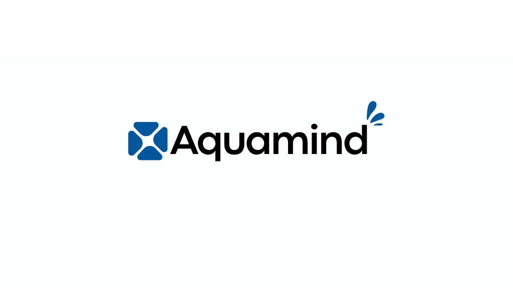
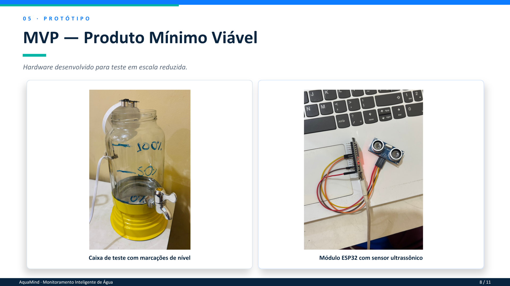
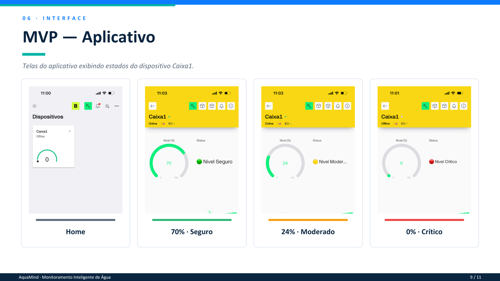

# PabloCossan

*IoT | Tecnologia e inovação*

Estudante de programação interessado no desenvolvimento de soluções tecnológicas para problemas reais. Minha trajetória inclui a participação no programa Do Piauí pro Mundo do governo do Piauí, que me proporcionou uma experiência de intercâmbio em Portugal e o desenvolvimento de projetos de inovação.

[LinkedIn](https://www.linkedin.com/in/pablocossan/) · [E-mail](mailto:pablocossan@gmail.com)

## Sobre mim

- Brasileiro e Píauiense.
- Intercambista do 3°DPPM (Portugal).
- Estudando [Análise e Desenvolvimento de Software].
- Desenvolvendo projetos para aplicar meus conhecimentos.
- Foco futuro: [Engenharia de Software] e [CyberSecurity].
- Buscando evoluir continuamente como desenvolvedor.
- Aberto a oportunidades de emprego.

## Tecnologias

  
  
  
  
  
  
  

*Sistemas embarcados: ESP32 · Arduino/C++*

Monitoramento e conectividade: Blynk · Wi-Fi

## Projetos

### AquaMind ( Projeto destaque )

  

AquaMind — Monitoramento inteligente de água

Projeto de IoT desenvolvido para auxiliar escolas no monitoramento do nível de água em reservatórios, contribuindo para uma gestão hídrica mais eficiente.

O MVP utiliza um ESP32 e um sensor ultrassônico para medir a distância até a superfície da água. Os dados são processados pelo microcontrolador e enviados via Wi-Fi ao Blynk, permitindo acompanhar o nível do reservatório remotamente.

Principais funcionalidades

Monitoramento do nível de água.

Visualização remota pelo Blynk.

Alertas para níveis críticos.

Lógica para identificar possíveis vazamentos.

Proposta de baixo custo e possibilidade de adaptação a diferentes reservatórios.

Tecnologias: C++ · ESP32 · Arduino IDE · HC-SR04 · Blynk · Wi-Fi

  
  

  Protótipo físico e interface demonstrativa do projeto.

[Repositório](https://github.com/olivindogabriel7-cpu/aquamind) 

---

*Em constante aprendizado.*
